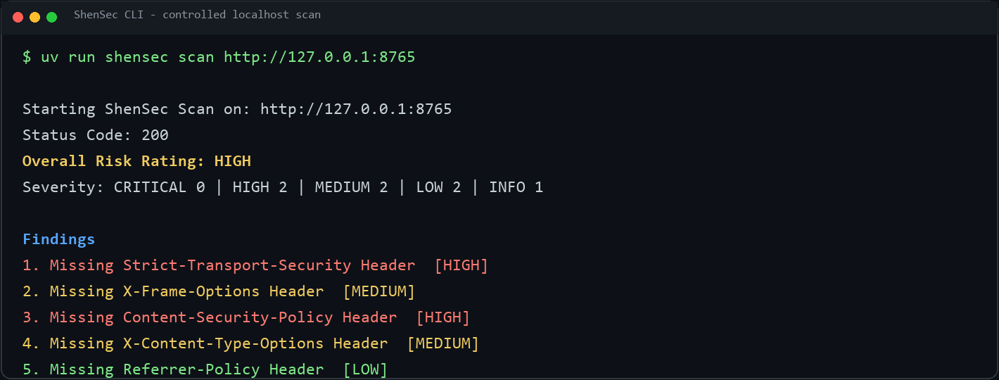
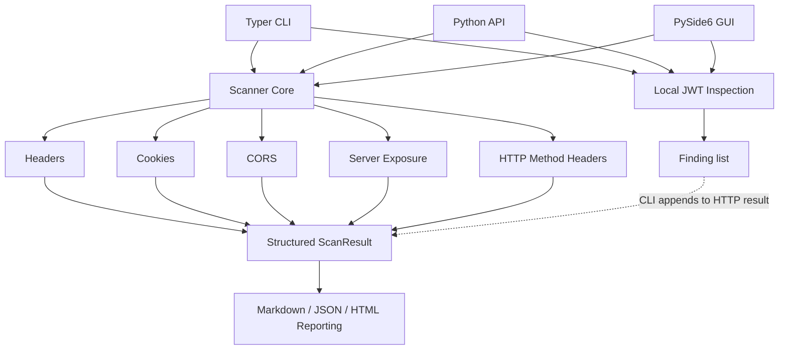
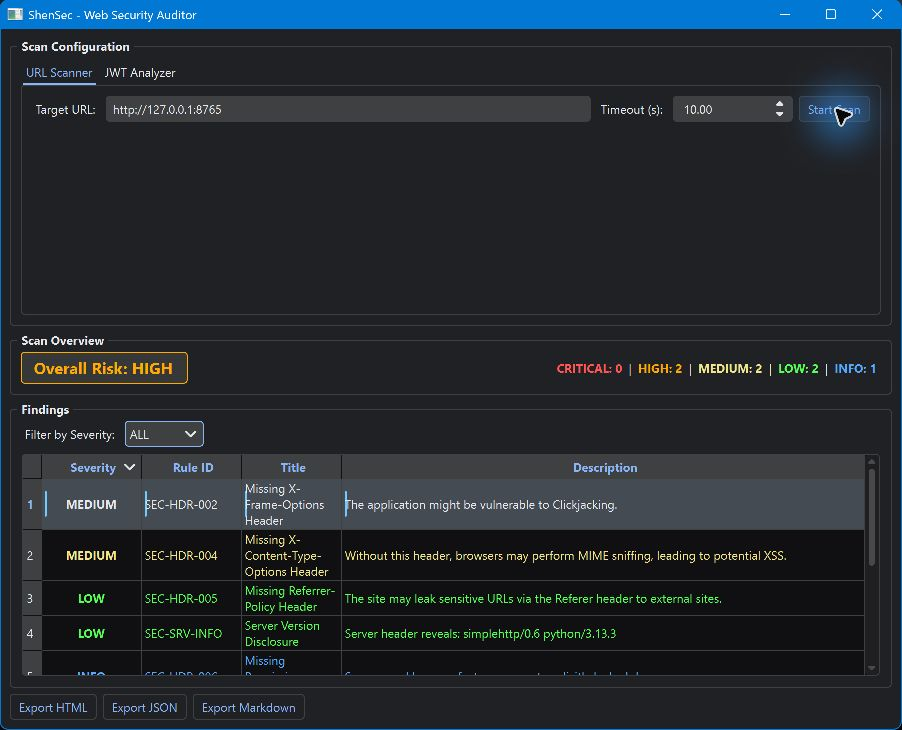

# ShenSec

**A lightweight defensive web security auditing toolkit for developers.**

[](pyproject.toml)
[](LICENSE)
[](tests/)
[](pyproject.toml)

Review **HTTP security headers, cookie flags, CORS, JWTs, and server information exposure** in systems you own or are authorized to assess. ShenSec turns focused configuration checks into structured findings with severity levels and remediation suggestions.

Use the **Typer CLI**, **reusable Python API**, or **PySide6 GUI** and export URL scan results as **Markdown, JSON, or HTML**.

## Quick start

Requires Python 3.13+ and uv. From a checkout of [shenming1115/ShenSec](https://github.com/shenming1115/ShenSec), with a local service listening on port 8000:

```bash
uv sync --locked
uv run shensec scan http://127.0.0.1:8000
```

Need a local target? Run `uv run python -m http.server 8000 --bind 127.0.0.1` in a separate terminal first. Stop it when finished.

The same scan from Python, using the project's environment:

```python
from shensec import scan_target

result = scan_target("http://127.0.0.1:8000", timeout=5.0)
print(result.risk_rating.value)
```

For a self-contained demonstration that starts and stops its own localhost target, run `uv run python examples/local_scan.py`.



## Example result

Abbreviated example output from the [controlled localhost sample report](examples/report.md):

```text
Risk Rating: HIGH

Findings (selected):
- Missing Strict-Transport-Security Header
- Cookie without HttpOnly flag: session
- Permissive CORS Policy
```

The full report includes rule IDs, severity counts, descriptions, and recommendations. These are demonstration findings, not an assessment of an external website.

## What it checks

| Capability | Implemented checks |
| --- | --- |
| HTTP security headers | HSTS, CSP, X-Frame-Options, X-Content-Type-Options, Referrer-Policy, and Permissions-Policy; selected weak values and missing directives |
| Cookie flags | Missing Secure, HttpOnly, or SameSite; SameSite=None without Secure |
| CORS | Wildcard `Access-Control-Allow-Origin: *` for contextual review |
| JWT inspection | Structure, decoding, algorithm and expiration checks, suspicious key references, and sensitive-claim heuristics; no signature verification |
| Server information exposure | Server and X-Powered-By headers, plus basic WAF/CDN header heuristics |

HTTP scans send a GET request, follow redirects, and send OPTIONS to inspect the Allow header. They flag advertised PUT, DELETE, or TRACE methods without executing them.

## What this project demonstrates

- **Python package architecture:** a `src/` layout separating analysis, interfaces, and reporting.
- **HTTP/security analysis:** focused rules for response headers, cookies, and local token inspection.
- **Typed structured data models:** Pydantic `Finding` and `ScanResult` models with severity levels.
- **CLI/API/GUI interface design:** shared functionality across Typer, Python, and PySide6.
- **Automated testing:** 26 passing local tests, including offscreen GUI and localhost integration tests.
- **Report generation:** Markdown, JSON, and template-based HTML from structured results.
- **Defensive security design:** bounded configuration checks with explicit limitations.

## Architecture



`scanner/core.py` orchestrates HTTP analysis and contains the CORS, server exposure, and method checks. Headers, cookies, and JWT rules have separate modules. JWT inspection returns a finding list; the GUI displays it separately and disables standalone JWT report export.

| Location | Responsibility |
| --- | --- |
| [src/shensec/](src/shensec/) | Public exports, API, CLI, and Pydantic models |
| [scanner/](src/shensec/scanner/) | HTTP and JWT analysis |
| [gui/](src/shensec/gui/) | Desktop interface and background workers |
| [reporting/](src/shensec/reporting/) and [templates/](src/shensec/templates/) | Report formatters and packaged HTML template |
| [tests/](tests/) and [examples/](examples/) | Regression tests and runnable examples |

## Reports and API usage

Export a report or inspect the CLI options:

```bash
uv run shensec scan http://127.0.0.1:8000 --format html --output result.html
uv run shensec scan --help
```

Use `--format json --output result.json` for machine-readable output; the console also prints progress messages. Markdown is the default format. `--jwt TOKEN` adds local token inspection to a URL scan.

In Python, `generate_report(result, "markdown")` returns report text. `analyze_response(response, url=...)` analyzes an existing HTTPX response without network requests, and `analyze_jwt(token)` returns local token findings. See the [offline API example](examples/basic_usage.py).

Summary caveat: `analyze_response` does not aggregate severity counts or risk. `scan_target` does, but the CLI's subsequently appended JWT findings do not update that summary. See [known limitations](docs/limitations.md).

## GUI

```bash
uv sync --locked --extra gui
uv run shensec gui
```

The PySide6 desktop interface provides URL scans, local JWT inspection, a sortable findings table, severity filtering, and report export for URL scans. Interactive use requires a desktop display.



## Testing and building

```bash
uv sync --locked --extra gui
uv run pytest
uv build
```

For headless GUI tests, set `QT_QPA_PLATFORM=offscreen` before pytest (`$env:QT_QPA_PLATFORM = "offscreen"` in PowerShell). Without the GUI extra, GUI tests are skipped.

The [GitHub Actions workflow](.github/workflows/ci.yml) is configured to run tests offscreen, check imports and CLI help, and build the package. The badge above records the verified local result; a remote CI run has not yet been verified. Build artifacts go to `dist/`; see [release verification](RELEASE.md).

## Security scope and limitations

Use ShenSec only on authorized systems, including redirect destinations. It does not crawl sites, exploit vulnerabilities, fuzz inputs, brute-force credentials, or execute injection attacks.

Findings are heuristics that require context: wildcard CORS and advertised HTTP methods can be legitimate, and JWT inspection does not verify signatures or prove server acceptance. A low rating is not proof of application security.

Connection failures are reported as `SEC-SCAN-ERR` with status code `0`; CLI exit status alone does not establish scan success. HTML reports currently do not escape target-controlled text, so review them before opening or sharing. See [known limitations](docs/limitations.md) for details.

## Roadmap

- Expand edge-case coverage and improve contextual findings.
- Make risk summaries consistent across HTTP and JWT analysis.
- Escape untrusted report text and clarify machine-readable CLI outcomes.
- Improve GUI accessibility.

Suggestions and bug reports are welcome through [GitHub Issues](https://github.com/shenming1115/ShenSec/issues).

## License

[MIT](LICENSE). Created by Ch'ng Shen Ming.
