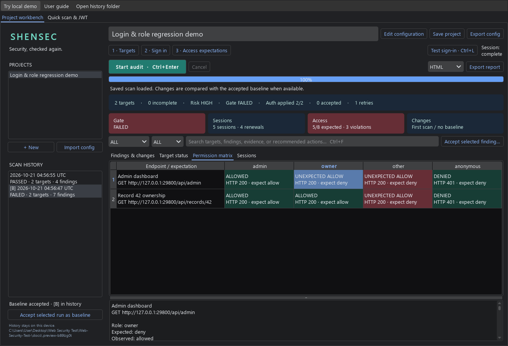
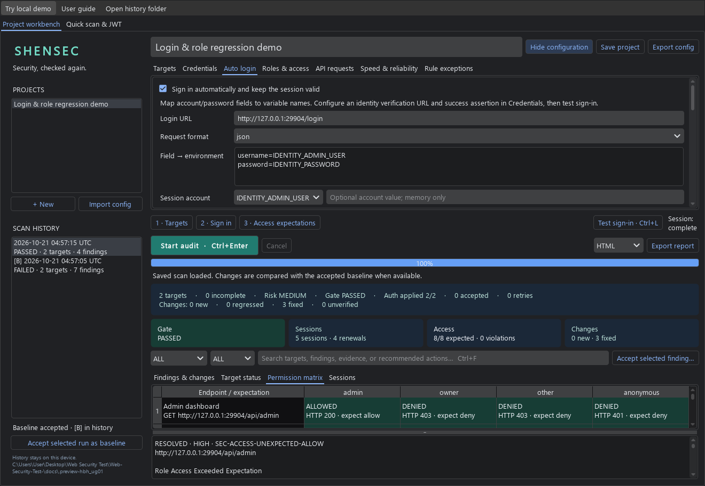
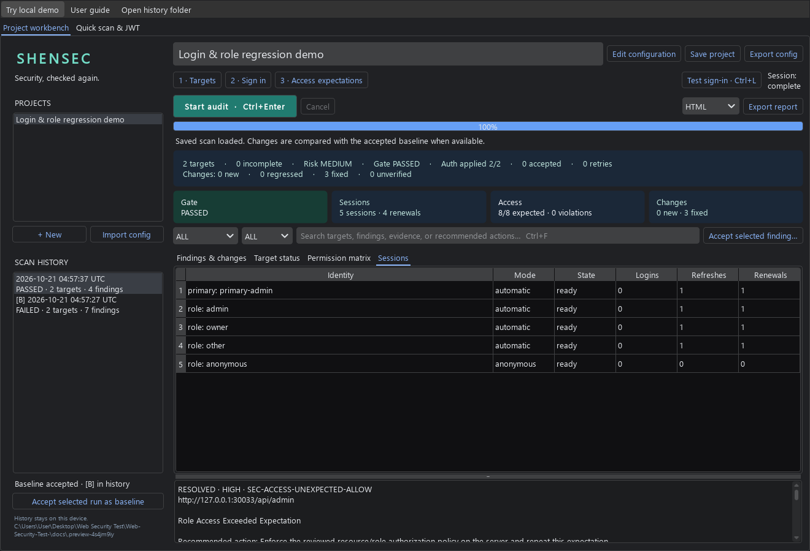

# ShenSec

**面向开发者的 API 安全回归工作台：自动登录、会话续期、多角色权限对比。**

支持登录后的 API 检查、OpenAPI 导入、自定义请求、历史与基线对比，以及 CI 风险门槛。**Windows exe 自带运行环境，双击即可使用。** 当前版本为 **0.5.0b1 测试版**。[English](README.md)

[下载 Windows exe](https://github.com/shenming1115/ShenSec/releases/download/v0.5.0b1/ShenSec-0.5.0b1-windows-x64.exe) · [便携 ZIP（启动更快）](https://github.com/shenming1115/ShenSec/releases/download/v0.5.0b1/ShenSec-0.5.0b1-windows-x64-portable.zip) · [完整使用教程](docs/windows-guide.zh-CN.md)

0.5 新增：

- **自动登录**：JSON／表单、CSRF、Cookie 或 Bearer 输出，必须通过身份断言验证成功。
- **会话续期**：提前刷新、Refresh Token 轮换、并发合并；安全请求在 401 后受控恢复。
- **多角色权限矩阵**：为每个角色声明允许／拒绝，用响应断言区分真实资源和登录页，结果进入历史与基线。
- **更直接的桌面操作**：分步入口、测试登录、临时账号密码和角色 Token、复制主身份、会话活动与权限结果卡片。

[自动登录、续期与角色配置指南](docs/identity-workflows.md)。新靶场覆盖 4 个角色、8 项权限预期；修复后解决 3 项超出预期的访问，并完成 4 次会话续期。

已有 API 能力：

- **真实 API 请求**：GET、HEAD、POST、PUT、PATCH、DELETE；环境变量请求体与预期状态码。
- **OpenAPI 导入**：本地 3.0/3.1 JSON、路径与查询参数绑定、明确的跳过原因。
- **CORS 行为验证**：可选双 Origin 探测，检查来源反射、凭据访问和 Vary，证据进入基线。
- **运行控制**：各线程共享来源速率预算；安全方法重试、Retry-After、可取消等待。
- **到期例外**：填写原因和有效期，保留证据；到期或撤销后重新进入新增问题门禁。
- **SARIF 输出**：关联仓库中真实的目标声明行，接入 GitHub Code Scanning。

[完整 API 配置与边界说明](docs/api-workflows.md)。原有 API 演示（`shensec demo`）包含认证 POST 与 CORS 修复前后对比：16 项已修复、2 项新 MEDIUM 观察、0 项未复查。

[查看 API 请求编辑器](docs/api-workbench.png)

## 先体验完整流程

1. 从 [GitHub Releases](https://github.com/shenming1115/ShenSec/releases/tag/v0.5.0b1) 下载 exe，直接双击。支持 Windows 10/11 x64，无需安装 Python、uv，无需命令行或管理员权限。
2. 点击顶部 **Try local demo**，等待数秒，独立演示窗口会展示四个角色、两个接口、修复前后历史和会话续期。
3. 在左侧选择较早的历史记录，点击权限矩阵的红色格子查看越权证据；选择最新记录查看修复结果。
4. 关闭演示窗口后，本地服务停止、临时数据删除；主窗口的日常项目保留。点击 **User guide** 可随时打开离线教程。

便携 ZIP 需要先完整解压，再双击 `ShenSec.exe`，保留旁边的 `_internal` 文件夹，适合每天频繁启动。单文件 exe 首次启动需要解包运行库。这一测试版尚未代码签名；系统可能提示发布者未知，请确认来自官方 Releases，并核对随包提供的 SHA256SUMS.txt 后按设备策略处理。



## 日常使用

双击 exe 后，按下面的流程操作。源码开发者仍可使用 `ShenSec.cmd`，或安装 uv 后运行 `uv run --locked --extra gui shensec gui`。

1. 新建项目，粘贴或导入 URL 清单。
2. 在 Credentials 中配置 Bearer、Cookie、API Key 对应的环境变量名；也可以临时粘贴会话凭据。Auto login 配置自动登录和续期，Roles & access 配置角色与权限预期。
3. 开始扫描，查看进度、目标状态、证据与修复建议；需要时取消。
4. 审核一次完整扫描，接受为基线。以后扫描会比较新增、严重度上升、已修复和未能复查的问题。
5. 在 API requests 中配置请求或导入 OpenAPI，在 Speed & reliability 中调整限速与重试。
6. 从历史打开扫描，或导出 HTML、JSON、Markdown、SARIF。接受风险时，为所选问题填写到期例外，再重新扫描。

临时凭据只保留在当前项目的进程内存中，重复扫描无需再粘贴。切换项目、清除会话或关闭应用后清除；来源范围变化时不会复用旧凭据。项目和报告不保存凭据值。环境变量方式适合反复运行和 CI；临时粘贴方式适合直接使用桌面应用。

默认数据目录是 `~/.shensec`，可通过 `--workspace 路径` 或 `SHENSEC_HOME` 修改。配置与历史保存在本地 SQLite，历史列表使用索引，不会每次加载所有报告。结果表使用 Qt 数据模型，支持按文字、严重度和变化筛选。





教程包含首次使用、账号登录、多角色权限、基线、报告、备份升级和故障处理：[Windows 使用教程](docs/windows-guide.zh-CN.md)。[截图说明及复现方法](docs/screenshots.md)。

## 自动化

```bash
uv run shensec init --name "Staging API" --target https://your-app.example/api/me --bearer-env APP_TOKEN
uv run shensec audit --config shensec.toml --format json --output baseline.json
uv run shensec audit --config shensec.toml --baseline baseline.json --only-new --fail-on HIGH --format json --output current.json
```

通过环境变量或已有的密钥管理方式提供 `APP_TOKEN`。`--bearer-env` 接收变量名。`audit --project 项目ID` 可以复用桌面项目并自动记录历史、使用已接受的基线。`project list`、`history`、`baseline` 和 `history --run` 提供查询、接受基线和导出功能。

退出码 `0` 为通过，`1` 为风险门槛不通过，`2` 为输入、认证、执行、取消或覆盖不完整。网络失败、删除目标、跳过检查和更换认证身份不会把旧问题误标为已修复。

## 性能与适用范围

一次 Windows/Python 3.13.3 本地测试：24 个目标、4 个线程、3 轮中位数，复用客户端后 **7307.74 → 1379.49 ms（5.30 倍）**，TCP 连接 **24 → 4**，检测结果一致。这是自带小响应靶场的对比，不代表所有网站都能达到同样倍数。可运行 `uv run python examples/benchmark.py` 复现。

认证支持已有凭据重放，以及 JSON／表单自动登录、CSRF、Refresh Token 和重新登录续期。自动登录和角色身份必须通过响应头或 JSON 断言验证。角色比较执行明确配置的 GET／HEAD 预期；浏览器 JavaScript 登录、交互式 OAuth、验证码和 MFA 不自动处理。工具只验证已配置的检查与预期。

[认证配置](docs/authentication.md) · [性能说明](docs/performance.md) · [CI 集成](docs/ci.md) · [功能边界](docs/limitations.md) · [项目方向](docs/project-direction.zh-CN.md)
