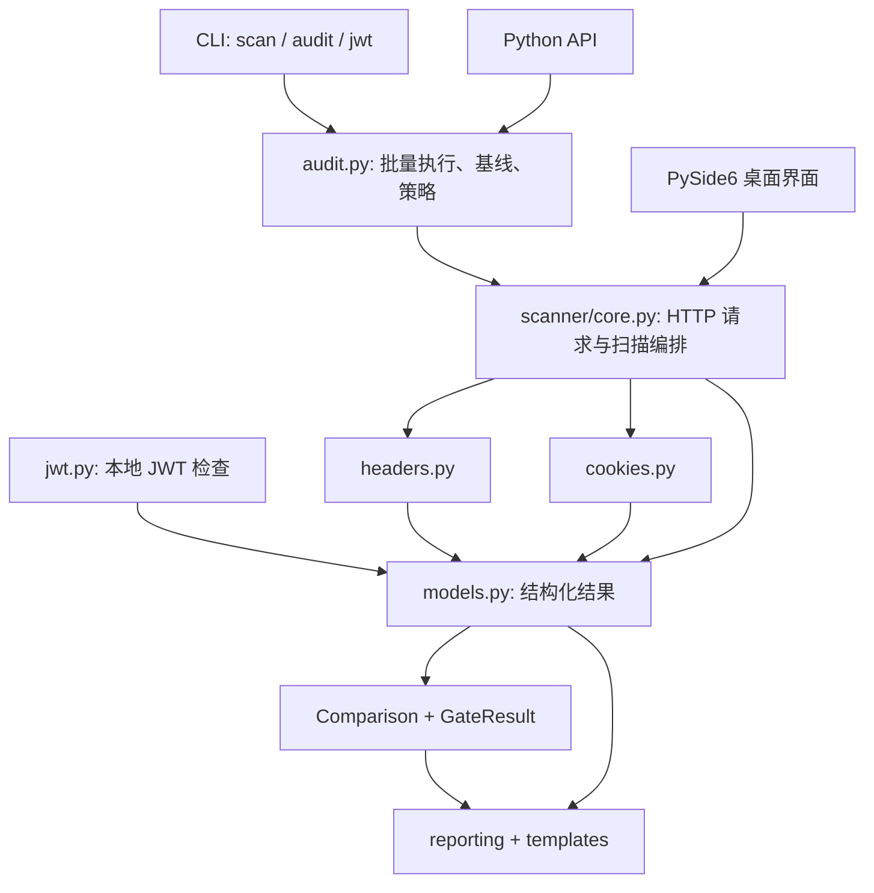

# ShenSec 项目现状与发展方向

## 原有能力

原版本是一个 Python 3.13 安全配置审计工具，拥有 Typer CLI、可复用 Python API 和 PySide6 桌面界面。可以检查 HTTP 安全响应头、Cookie 属性、通配 CORS、服务端信息暴露、OPTIONS 宣告的方法，以及本地 JWT 的结构、算法、过期时间和可疑声明。结果可导出为 Markdown、JSON 和 HTML。

它原本适合单地址快速检查，但缺少多目标工作流、历史对比和自动化策略。代码中还存在摘要与明细不同步、连接失败退出码不可靠、报告内容未转义，以及桌面端看不到修复建议等实际使用问题。

## 建议定位

把 ShenSec 做成**开发者的 Web 安全配置回归工具**：第一次发现配置问题，接受经审核的现状；之后每次部署都检查是否产生新的高风险配置、是否修好了旧问题，以及哪些入口没有完成检查。

这个方向能复用已有的 HTTP 检查、结构化模型和三种界面，也能形成清楚的使用闭环：**目标清单 → 扫描 → 证据 → 修复 → 复查 → CI 门槛**。产品价值来自结果可信、修复方便、适合重复使用。全面渗透测试平台需要远超当前项目规模的扫描引擎、认证处理、漏洞验证和规则维护投入。

## 本次已实现

| 能力 | 使用价值 |
| --- | --- |
| `audit` 多目标命令 | 读取 URL 清单，去重，1–16 个工作线程，有序输出，最多 1000 个目标 |
| JSON 基线 | 标识新增、仍存在、已修复、严重度上升和未能复查的问题 |
| CI 策略 | 设置严重度门槛，支持只拦截新增及严重度上升的问题 |
| 可靠的执行状态 | 完成、部分完成、失败与风险等级分开；错误页和网络错误不会当作通过 |
| 覆盖保护 | 被移除的目标、跳过或失败的检查不会让旧问题被误标为修复 |
| 证据与建议 | 记录相关响应头，Cookie 值脱敏，报告按严重度排序 |
| HTTP 引擎 | 流式读取响应头，不读取正文；限制重定向；默认控制跨来源跳转；保留重定向 Cookie 观察 |
| 减少误报 | 区分 HTML/API，HTTP 不再被提示直接添加 HSTS，识别有效 CSP framing 控制，精确解析 Allow 方法 |
| 安全报告 | HTML 自动转义、离线资源和内容策略，Markdown 转义外部内容，JSON stdout 可直接解析 |
| 桌面体验 | 文本搜索、证据与修复建议面板、按严重度排序、独立 JWT 导出与汇总、失败状态提示 |
| 本地演示 | 两个入口，修复前后对比，实际生成 HTML/JSON/Markdown，自动关闭本地服务 |

上述能力已在后续的 0.3 测试版继续扩展：桌面项目工作台现在也支持批量扫描、历史记录和基线对比。

## 代码结构与数据流

`models.py` 定义所有界面共用的数据结构，风险和计数由 findings 自动计算。`targets.py` 负责 URL 验证和归一化。`scanner/` 负责观察目标，`audit.py` 负责比较与决策；报告层只负责展示结果。后续增加规则时，要同时提供稳定的规则 ID、影响位置、证据和修复建议。

## 下一阶段的优先级

1. **认证与项目配置：核心已完成**。Bearer/Cookie/API Key 环境变量引用、进程内会话凭据、可导入导出的 TOML/JSON 配置、来源限制、可选登录状态验证、报告脱敏。现已支持有原因和到期日的规则例外，保留证据并在到期后重新进入门禁。
2. **桌面项目工作台：已完成**。批量目标导入、SQLite 历史、基线选择、变化筛选、证据与建议、进度与取消。桌面与 CLI 共用 `audit.py`，连接按工作线程复用，Cookie 按目标隔离。
3. **更准确的检查**：完整 CSP 语义、CORS 预检验证、TLS 证书元数据、缓存与敏感响应策略。每条规则需要可复现的测试场景和清楚的适用条件。
4. **开发工作流集成：核心已完成**。SARIF 输出可关联真实目标声明行，支持共享来源限速、安全方法重试和 Retry-After。还新增 OpenAPI 导入和显式 API 请求配置。

前两项的核心流程已经形成“真实登录后的多入口检查 + 易用的历史对比”。新增了自带认证本地靶场、Windows 启动入口、源码安装流程、中英文说明、性能脚本、贡献指南和三平台 CI 配置。0.4 已实现 API 请求计划、OpenAPI 导入、CORS 双来源验证、限速重试、到期例外和 SARIF。0.5 继续实现 JSON／表单自动登录、CSRF、受控续期、身份断言与多角色权限矩阵。下一步依据实际反馈完善浏览器身份接入、完整 CSP 语义与 TLS 证书检查；当前边界见 identity-workflows.md。
