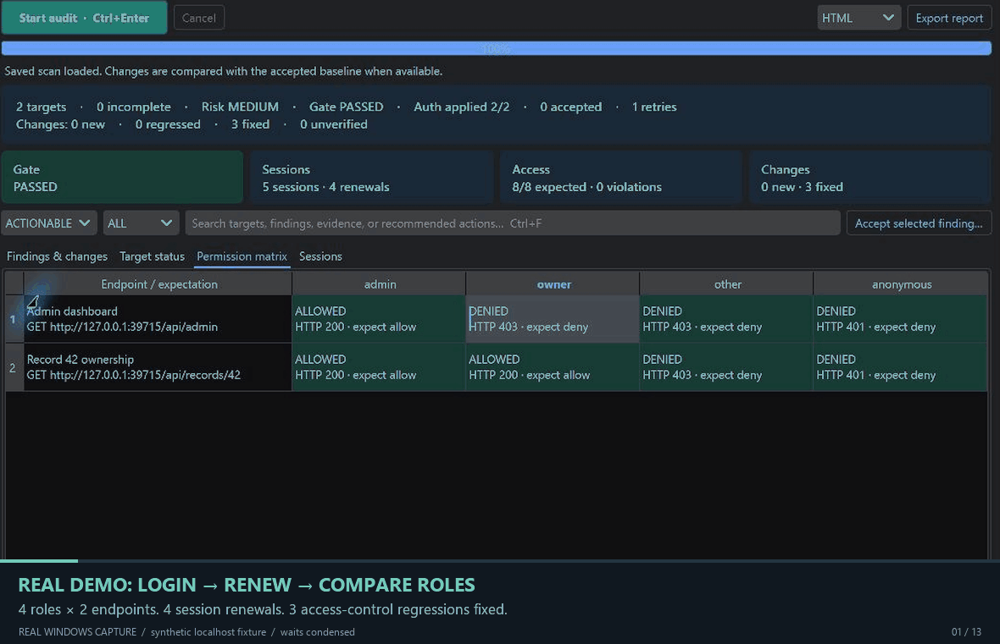

# Real desktop screenshots

## Real Windows demo GIF

[](demo-workflow.gif)

The README walkthrough was recorded on Windows on 2026-10-21 from the **published [0.5.0b1 standalone exe](https://github.com/shenming1115/ShenSec/releases/tag/v0.5.0b1)**. It captures native window pixels while operating the app and running real HTTP checks against its built-in loopback fixture. Accounts and credentials are synthetic.

The sequence opens **Try local demo**, shows the JSON login and refresh configuration, starts a fresh audit, inspects each identity's renewal counts, and compares the vulnerable baseline with the hardened run. The recorded run shows **4 roles × 2 endpoints, 4 renewals, 8/8 permission expectations met, and 3 unexpected grants fixed**. The owner/admin cell changes from HTTP 200 before hardening to HTTP 403 afterward.

The GIF contains 13 selected scenes, loops every 27.2 seconds, and is approximately 1.4 MB at 1180 × 761 pixels. An opening preview shows the result before the walkthrough. Edits are limited to selecting captures, shortening waits, cropping/enlarging details, and adding explanatory captions below the captured UI. The UI and results are unchanged. Playback timing is not a performance benchmark. [Capture provenance and media checksums](demo-workflow.json) include the published exe's SHA-256 and individual source-frame hashes.

`examples/build_demo_gif.py` encodes existing captures using Pillow; it does not operate the app or generate UI. To assemble your own recording:

```powershell
uv run --no-project --with pillow==12.3.0 python examples/build_demo_gif.py --manifest path/to/frames.json --output docs/demo-workflow.gif
```

The input JSON contains `source`, `source_exe_sha256`, `recorded_on`, and a `frames` list. Each frame specifies a relative `file` path, `title`, `detail`, `duration` in milliseconds, and optional `captured_at`, `crop` (`left, top, right, bottom`) or `skip`. An optional `preview` object references a source frame using the same fields; omit it for a chronological sequence. Put private raw captures under ignored `examples/demo-output/`; publish only the reviewed GIF and its generated provenance JSON.

## Static workbench screenshots

These images come from the actual Qt workbench and authenticated loopback HTTP fixtures, using `examples/capture_workbench.py`. They are not UI mockups. Fixture credentials are synthetic. The role screenshot deliberately selects the older, vulnerable run; the session screenshot selects the hardened run.

| Image | What it demonstrates |
| --- | --- |
| [Permission matrix](permissions-workbench.png) | Four roles, two endpoints and three unexpected grants before hardening |
| [Automatic login](login-workbench.png) | Guided login, expiry and verification configuration |
| [Sessions](sessions-workbench.png) | Login/refresh activity after hardening |
| [API requests](api-workbench.png) | Explicit request plans and the API editor |
| [Findings](workbench.png) | History, comparison filters and evidence |

Reproduce from a source checkout with the GUI extra installed:

```powershell
$env:QT_QPA_PLATFORM = 'offscreen'
uv run python examples/capture_workbench.py --identities --before --view permissions --output docs/permissions-workbench.png
uv run python examples/capture_workbench.py --identities --view login --output docs/login-workbench.png
uv run python examples/capture_workbench.py --identities --view sessions --output docs/sessions-workbench.png
uv run python examples/capture_workbench.py --configure --output docs/api-workbench.png
uv run python examples/capture_workbench.py --output docs/workbench.png
```

For binary verification, `ShenSec.exe --self-test OUTPUT` renders the actual bundled Qt application and writes a screenshot, reports and a JSON verification result. This flag is for release automation; normal desktop use requires no command.
